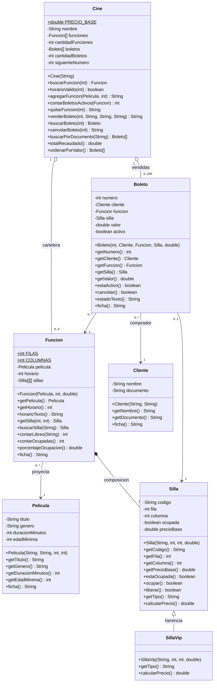

# Cinema ITM - Sistema de gestion de una sala de cine

Proyecto final de Logica de programacion y laboratorio, ITM 2026-2, grupo 27.
Docente: Sebastian Montoya Villada.
Estudiante: Jimmy Stebym Rosero Barrera (trabajo individual).

## Enunciado del problema

Un cine tiene una sola sala con 24 sillas organizadas en 4 filas (A, B, C y D) de 6 sillas
cada una. Las filas A y B son de zona general y las filas C y D son de zona VIP, que cuesta mas.

En el dia la sala proyecta varias funciones, cada una con su pelicula y su horario, y el
cine puede agregar o quitar funciones de la cartelera. Como cada funcion es en una hora
distinta, cada una tiene sus propias sillas libres y ocupadas.

Hoy la venta se lleva a mano y pasan problemas como vender dos veces la misma silla,
no saber quien compro una boleta o no tener claro cuanto dinero se recaudo.

El sistema debe manejar la cartelera, mostrar que sillas estan libres y cuales ocupadas
en cada funcion, vender boletas sin permitir vender una silla ocupada, cancelar boletas
liberando la silla, buscar quien reservo y entregar un reporte del dinero recaudado y de
la ocupacion.

## Reglas del negocio

- RN1. La sala tiene 24 sillas: filas A a D y columnas 1 a 6. Una silla se identifica con
  su fila y su columna, por ejemplo B3.
- RN2. Las filas A y B son zona general y las filas C y D son zona VIP.
- RN3. La boleta general cuesta $12000 y la VIP tiene un recargo del 30% ($15600).
- RN4. La cartelera tiene maximo 5 funciones y no puede haber dos funciones a la misma hora,
  porque solo hay una sala.
- RN5. Cada funcion tiene sus propias sillas. Una silla ocupada en una funcion no se puede
  vender otra vez en esa misma funcion.
- RN6. Solo se puede cancelar una boleta que exista y que este activa. Al cancelarla la
  silla queda libre otra vez y el dinero de esa boleta ya no cuenta en el recaudo.
- RN7. No se puede quitar de la cartelera una funcion que tenga boletas activas.
- RN8. El porcentaje de ocupacion de una funcion es la cantidad de sillas ocupadas por 100
  entre 24.

## Requisitos funcionales

- RF1. Ver la cartelera con las funciones: pelicula y horario.
- RF2. Agregar una funcion a la cartelera. Se rechaza si la cartelera esta llena, si ya hay
  una funcion a esa hora o si faltan datos.
- RF3. Quitar una funcion de la cartelera. Se rechaza si no existe o si tiene boletas activas.
- RF4. Ver el mapa de sillas de una funcion, con las sillas libres y ocupadas.
- RF5. Vender una boleta: se escoge la funcion y la silla, y se ingresan el nombre y el
  documento del cliente. Se rechaza si la silla no existe, si ya esta ocupada o si faltan datos.
- RF6. Cancelar una boleta por su numero. Se rechaza si el numero no existe o si la boleta
  ya estaba cancelada.
- RF7. Buscar las boletas de un cliente por su documento, para saber quien reservo.
- RF8. Contar las sillas libres de cada zona (general y VIP) en una funcion.
- RF9. Generar el reporte con el dinero recaudado (solo boletas activas) y el porcentaje de
  ocupacion de cada funcion.
- RF10. Listar las boletas vendidas ordenadas por valor, con un algoritmo de ordenamiento
  propio (valor agregado).
- RF11. Guardar y cargar las boletas en un archivo de texto (valor agregado).

## Requisitos no funcionales

- RNF1. El programa esta hecho en Java 25 con programacion orientada a objetos y se
  ejecuta en NetBeans.
- RNF2. La interfaz es grafica, hecha con Swing, y esta conectada a las clases del modelo.
  Las reglas del negocio estan en las clases del modelo, no en las ventanas.
- RNF3. Los objetos se guardan en arreglos de tamano fijo con un contador. No se usa
  ArrayList ni otras colecciones dinamicas.
- RNF4. Un dato invalido se rechaza con un mensaje claro y no cierra el programa.
- RNF5. El programa arranca con datos precargados (tres funciones y algunas boletas
  vendidas) para poder probarlo de una vez.
- RNF6. Cada clase y cada metodo tiene un comentario corto que explica que hace.
- RNF7. El codigo se maneja con Git y se publica en GitHub, con un commit por cada avance.

## Diagrama de clases UML

### Relaciones

- Herencia: SillaVip hereda de Silla. Usa el mismo constructor con super y sobrescribe
  getTipo() y calcularPrecio() para cobrar el recargo del 30%.
- Composicion (Funcion con Silla): cada funcion crea sus 24 sillas en su constructor. Si la
  funcion se quita de la cartelera, sus sillas desaparecen con ella.
- Agregacion (Cine con Funcion y Boleto): el cine guarda las funciones y las boletas en
  arreglos de tamano fijo (5 y 100) con su contador.
- Asociacion: una funcion proyecta una pelicula, y cada boleto conoce a su cliente, su
  funcion y su silla.

## Avance por semanas

- [x] Semana 1. Propuesta: enunciado, reglas del negocio y requisitos.
- [x] Semana 2. Diseno: diagrama de clases UML y clases del modelo.
- [ ] Semana 3. Funcionalidad: requisitos funcionando con sus validaciones.
- [ ] Semana 4. Cierre: interfaz grafica, pruebas, documento y sustentacion.
